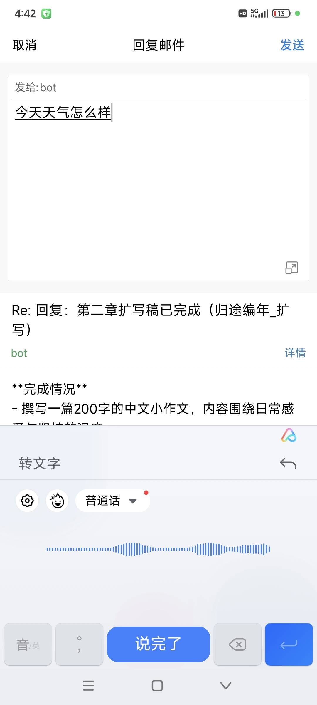
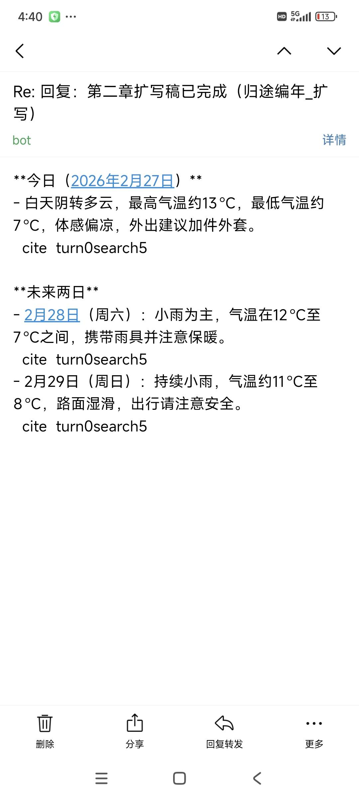
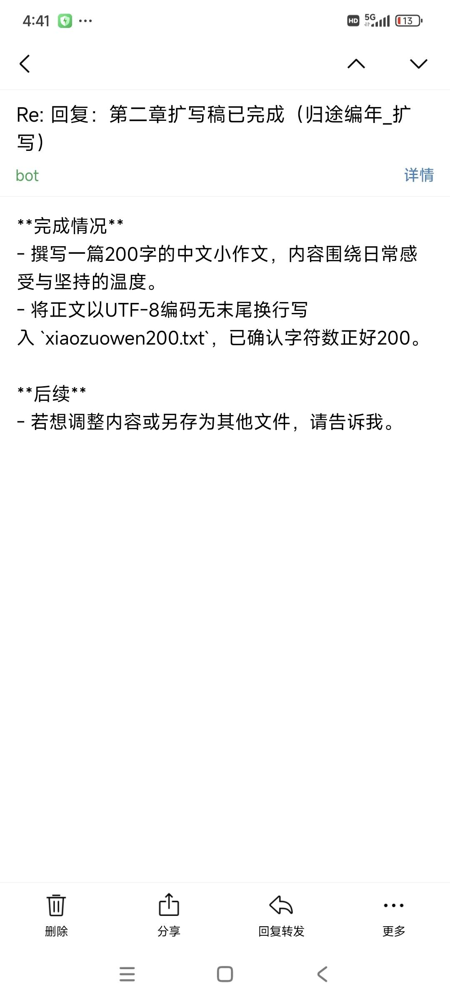
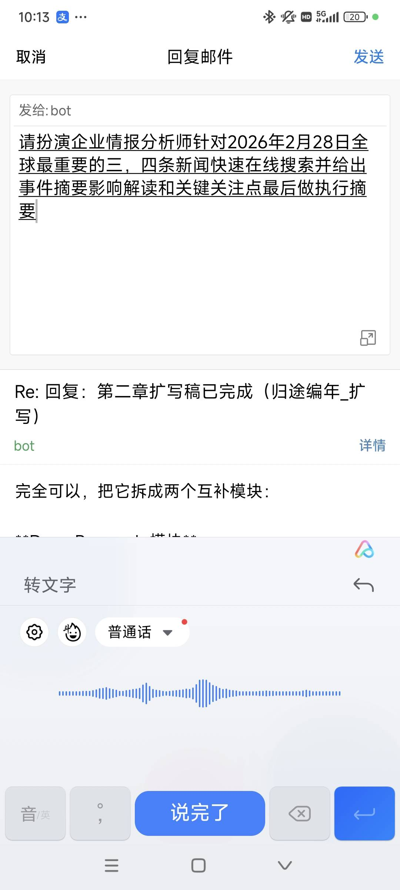
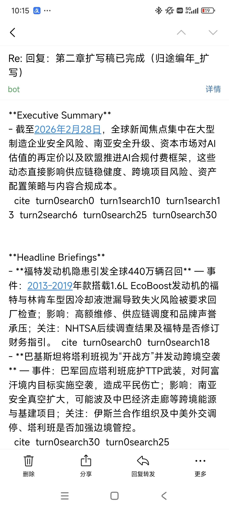

# dmail

English | [简体中文](#简体中文)

<table>
  <tr>
    <td></td>
    <td></td>
    <td></td>
  </tr>
  <tr>
    <td></td>
    <td></td>
    <td></td>
  </tr>
</table>

**Minimal email-based chat system.**
All extra functionality is delegated to an **agent**.

**100 lines of Python.**
Send an email, the agent starts working.

## Usage

Edit the config at the top of `dmail.py`, then run:

```bash
python dmail.py
```

## Configuration

```python
USER_EMAIL  = "user@qq.com"             # your email (whitelist; leave empty to disable filtering)
AGENT_EMAIL = "agent@qq.com"            # agent email
AGENT_AUTH  = "agent_auth_code"         # authorization code
AGENT_CMD   = 'claude -p "{prompt}" --continue --dangerously-skip-permissions'  # agent command (--continue enables multi-turn conversation)
INTERVAL    = 6                        # polling interval (seconds)
```

To switch agents, just change `AGENT_CMD`, e.g.:

`codex exec "{prompt}" resume --last --dangerously-bypass-approvals-and-sandbox`
or
`gemini -p "{prompt}" -r latest --yolo`.

**Authorization code:**
QQ Mail → Settings → Account → Enable IMAP/SMTP → Generate authorization code.


---

# 简体中文

[English](#dmail) | 简体中文

极简邮件聊天系统，把一切额外功能托管给 agent。
100 行 Python 实现，给邮箱发消息，agent 开始干活。

## 用法

改 `dmail.py` 顶部配置，然后：

```bash
python dmail.py
```

## 配置

```python
USER_EMAIL  = "user@qq.com"             # 你的邮箱（白名单，留空不过滤）
AGENT_EMAIL = "agent@qq.com"            # agent 邮箱
AGENT_AUTH  = "agent_auth_code"         # 授权码
AGENT_CMD   = 'claude -p "{prompt}" --continue --dangerously-skip-permissions'  # agent 命令（--continue 多轮对话）
INTERVAL    = 6                        # 轮询间隔（秒）
```

换 agent 只改 `AGENT_CMD`，如 `codex exec "{prompt}" resume --last --dangerously-bypass-approvals-and-sandbox`、`gemini -p "{prompt}" -r latest --yolo`。

授权码：QQ邮箱 → 设置 → 账户 → 开启 IMAP/SMTP → 生成授权码。
